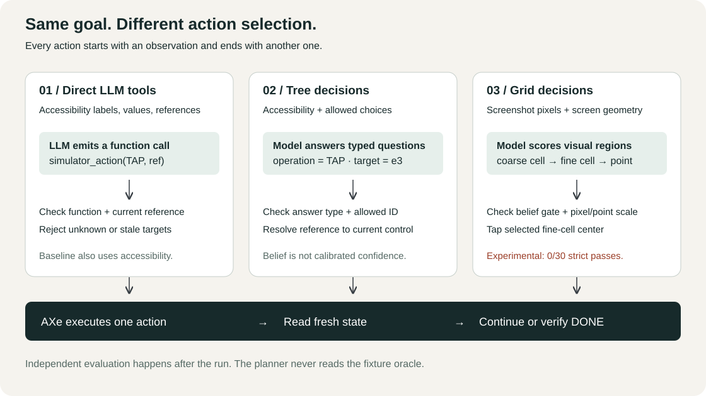
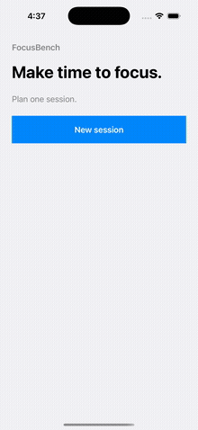
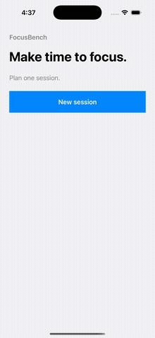
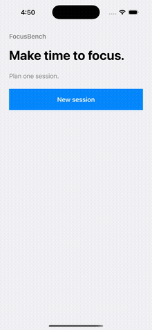
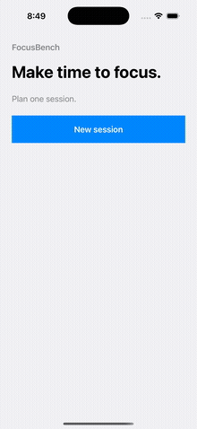
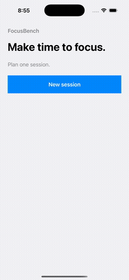
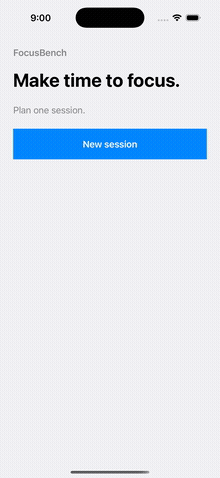
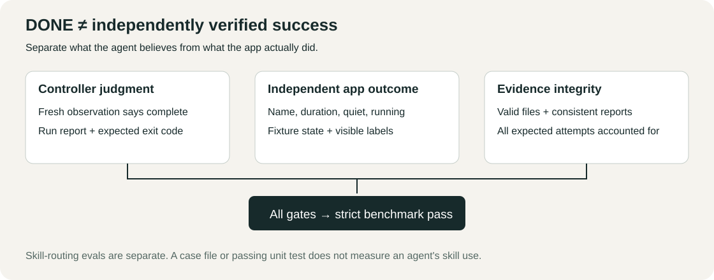

# AXe Decision Control

**Learn how AI controls an iOS Simulator: direct tool calls, accessibility decisions, screenshot grids, and image boundaries.**



**[Open the visual field guide](docs/index.html)** · [Install the plugins](docs/plugins.md) · [Run evaluations](docs/evaluations.md) · [Inspect historical results](docs/results.md)

GitHub displays source for HTML. Open the guide locally to use its **seven video recordings, saved-event stepper, and interactive grid**. No API key or simulator needed to learn:

```sh
git clone https://github.com/Saik0s/axe-decision-control.git
cd axe-decision-control
open docs/index.html  # macOS; otherwise open the file in your browser
```

## New: Jev 1.14 finds the boundaries

**[Watch the Jev 1.14 visual demo →](docs/jev-1.14.html)** Three new native recordings from **15 October 2026**: start **Review PR**, **50 minutes**, **Quiet mode on**, from an empty name, 10 minutes, and Quiet mode off.

| Jev + accessibility | Jev + screenshot grid | Jev + image boundaries |
| :---: | :---: | :---: |
|  |  |  |
| **Independent pass** · 8 requests | **Independent pass** · 22 requests | **Independent pass** · 18 requests |
| [Original video](results/jev-1.14-2026-10-15/tree/original.mp4) | [Original video](results/jev-1.14-2026-10-15/grid/original.mp4) | [Original video](results/jev-1.14-2026-10-15/box-image-fix/box/original.mp4) |

Tree, grid, and box now select **`typesafe/jev-1.14` through OpenRouter** by default. All three recordings resolved to `typesafe/jev-1.14-20261014`. Box asks for normalized edges, validates presence and confidence, converts the center to simulator points, then rechecks freshness before tapping. The [step-through lesson](docs/jev-1.14.html#boundaries) shows actual answers and all five box attempts, including four failures.

**Images and boxes remain experimental.** Box receives an additional caller-described target catalog; these demonstrations do not isolate the effect of localization strategy or establish general app accuracy. The native evaluator checks persisted app state and visible results separately from model completion. [Reproduction and evidence](results/jev-1.14-2026-10-15/README.md).

## Historical comparison: the same task three ways

Goal: start **Ship demo**, **25 minutes**, **Quiet mode on**. Real native recordings from **5 October 2026**, using the synthetic FocusBench app. Previews retain original playback timing at a reduced frame rate; originals are linked below. They are separate runs, not a synchronized race.

| Direct LLM tools | Clef + accessibility | Clef + screenshot grid |
| :---: | :---: | :---: |
|  |  |  |
| **Pass** · GPT-4.1 mini | **Pass** · Clef | **Blocked** · Clef |
| [Original video](results/native-comparison/gpt-direct/basic/repeat-0/original.mp4) | [Original video](results/native-comparison/clef-tree/basic/repeat-0/original.mp4) | [Original video](results/native-comparison/clef-grid/basic/repeat-0/original.mp4) |

See **all seven systems**, including Jev and local Winnow, in the [visual guide](docs/index.html#replays). The same first basic-scenario episode is shown for each, including failures. [Raw episodes](results/native-comparison/report.md) retain the full comparison.

## What changes inside the loop?

| Mode | Model receives | Model returns |
| --- | --- | --- |
| Direct | Accessibility state and a bounded function schema | One `simulator_action` tool call |
| Tree | Accessibility state, allowed operations and targets | Typed answer IDs; program resolves native action |
| Grid | Screenshot pixels, grid geometry and goal | Coarse/fine region judgments; program converts center to points |
| Box | Screenshot, goal and optional caller-described target catalog | Typed target selection and normalized edges; program gates and converts the center to points |

All four validate the choice, execute through AXe, then read fresh state. **Direct also uses accessibility.** Different models and hosting mean these observations do not isolate the effect of tree versus grid. Numeric beliefs are uncalibrated, not safety guarantees.

## Evaluate outcomes, not promises



Historical native comparison from **5 October 2026**: **105 episodes**, **7 model/mode pairs × 5 scenarios × 3 repeats**. **46 strict passes, 59 failures**. Clef/Winnow grid recorded **0/30 strict passes**. The newer Jev demonstrations are separate evidence and do not change that denominator. These are synthetic fixture results, not general app accuracy or measured skill quality. The [evaluation guide](docs/evaluations.md) separates offline integrity checks, skill-agent evaluations, and native benchmarks.

## Try the controller or install a plugin

```sh
uv sync --frozen
uv run axe-control --help
uv run axe-control doctor
```

Learning and offline checks need Python **3.12+** and uv. Native control also needs **macOS, Xcode, AXe, one explicitly selected booted simulator, and its logical dimensions**. Provider services and credentials are external. Cloud execution sends the goal and app state to the selected provider and can incur charges.

**[Claude Code and Codex installation →](docs/plugins.md)** Both plugins use one canonical [`skills/`](skills/) bundle with self-contained references. Installing a plugin does not install the Python CLI, native tools, model weights, or services.

**[CLI and library recipes →](docs/usage.md)** · **[Local Winnow setup →](docs/local-winnow.md)**

[Offline CI](.github/workflows/checks.yml) checks behavior, packaging, strict types and saved evidence without model calls. Host plugin execution and new native benchmarks remain separate validation lanes.

## Find the part you want to learn

```text
.claude-plugin/  Claude Code plugin manifest and marketplace
.codex-plugin/   Codex plugin manifest
skills/         Shared agent workflows and their bundled references
src/            Small bounded controller, planners and provider adapters
evals/          Explicit evaluation cases and offline grading
benchmarks/     Native and local-inference measurement harnesses
fixtures/       Seeded SwiftUI app used for repeatable tasks
results/        Dated recordings, screenshots and raw measurements
docs/           Visual lessons first; technical references on demand
tests/          Behavior and contract regression checks
```

[Architecture](docs/architecture.md) · [Provider contracts](docs/provider-contracts.md) · [Benchmark reproduction](docs/benchmarks.md) · [Packaging](docs/releasing.md)

<details>
<summary>Evidence limits and privacy</summary>

Historical benchmark recordings and inference measurements date from **5 October 2026**; the Jev 1.14 demonstrations are dated **15 October 2026** and retain their separate attempts. New documentation, manifest validation, and offline tests do not refresh benchmark performance. The direct benchmark uses GPT-4.1 mini, not the Codex/NTM presentation agent. Failures remain in every benchmark denominator. Controller `completed` is a model judgment; the native evaluator checks independent app state and visible facts.

`observe` explicitly saves app content. Default run reports contain bounded metadata and numeric telemetry, not private goals or text. Grid sends screenshots to the configured provider. Never commit credentials. Local monetary cost is unknown when unreported, not zero. See [data handling](docs/usage.md#data-and-observations).

</details>

## License

Igor Tarasenko · [MIT](LICENSE). AXe, provider services and model weights retain their own licenses and terms.
