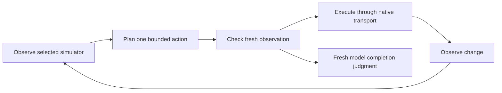

# Architecture

This describes the current source contracts. [Results](results.md) documents the
measured evidence separately. The library separates observations, provider wire formats,
planning, bounded native actions, and independent benchmark evaluation.
The 2026-10-15 source update selects OpenRouter `typesafe/jev-1.14` by default for
tree/grid/box, requiring resolved identity `typesafe/jev-1.14-20261014`.
Grid and box remain experimental; provider image/box support is separate from
native task success. See [provider contracts](provider-contracts.md).

## Control loop

`runner.run(provider, transport, task, config)` owns this loop. `Task` preserves
the user's goal, approved literal catalog, and optional `target_descriptions`
list. Repeated CLI `--target` options populate that list; only box uses it.
`RunConfig` owns limits and belief
thresholds. `NativeTransport` owns tree, screenshot, and action operations; the
AXe implementation binds every command to an explicit simulator UDID. `Provider`
owns capabilities, typed decisions, generative function calls, identity, usage,
and shutdown. Provider-specific JSON stays in provider adapters.

## Planner boundaries

- **Tree:** normalizes visible accessibility state and exposes snapshot-local
  candidates. The default snapshot limit is 25 candidates; the planner additionally
  respects the provider's choice capacity. It requests typed operation, target,
  and optional literal choices, plus Noul completion judgments. Truncation can
  hide a needed control; it is not evidence that the goal is complete.
- **Grid:** receives only screenshots, goal/literals/history, and supplied geometry.
  It never obtains accessibility labels, selectors, or control bounds. Each tap
  evaluates coarse cells, then fine-cell centers using a full image and crop.
  Defaults are 4×8 coarse and 4×4 fine; requests batch at the provider's question
  limit. Pixels convert to points independently on each axis:
  `x_points = x_pixels * point_width / image_width`, similarly for y.
- **Box:** receives the same visual inputs as grid, with no accessibility labels,
  selectors, control bounds, or benchmark oracle, plus optional caller-described
  targets. A typed Choice target question accompanies operation selection;
  the selected description becomes the explicit localization subject. Generic
  next-control localization without descriptions remains supported, with greater
  ambiguity. These descriptions guide choices rather than prescribe a fixed
  click sequence. Box requires typed decisions,
  vision, and `capabilities.boxes`, currently exposed only by JeV 1.14. The
  planner pairs a Noul visible-presence judgment with a Box question requesting
  an enabled control with an unobstructed center. Finite normalized edges must satisfy
  `0 <= left < right <= 1` and `0 <= top < bottom <= 1`; confidence is in [0, 1].
  The center maps directly to logical points:
  `x_points = (left + right) / 2 * point_width`, similarly for y. A returned box
  alone cannot establish presence: the primitive returns one for absent targets.
- **Direct:** sends accessibility state to a generative model and requires one
  real `simulator_action` function call. The adapter validates the call and its
  arguments; the planner rejects point targets and text outside the approved
  catalog. These are simulator tools, not shell commands or generated host code.

Box permits one bounded crop refinement when both preliminary presence and
confidence are at least 0.5 but either misses its configured final gate (defaults
0.9/0.8). The crop adds 6% of full-image width/height around each candidate edge,
clips to the image, and asks about the same target. Returned crop-relative edges
map back to full-image normalized coordinates before center-to-point conversion.
The crop is enlarged 2× before provider preparation caps each side at 1568 pixels.
Scores below 0.5 skip refinement. This adds at most one localization request per
plan within the existing budget; final gates and freshness checks remain in force.

Tree freshness compares semantic snapshot digests. Grid/box freshness and post-action
change use images only: the current heuristic excludes the top 6% status strip,
resizes to 240×480, and compares mean RGB difference to a default tolerance of
1.5. A second check detects localized differences above 32 luminance levels
covering more than 0.1% of the resized app area (at least 64 pixels). This avoids
averaging away a changed text field or toggle while ignoring sparse caret noise.
The heuristic remains uncalibrated and can miss subtle changes. A changed screen
shows a change, not that the intended result was achieved. Grid/box text entry also
requires a preceding focus tap associated with the selected approved literal.
They share visual intent and completion logic; neither obtains accessibility data
for planning, freshness, or completion.

JeV 1.14 image preparation is owned by the provider adapter. It uses the image
opt-in header and text/`image_url` state parts, preserves aspect ratio when
resizing screenshots or upscaling small grid crops, and validates PNG/JPEG
dimensions and byte limits before HTTP. The adapter's conservative minimum side
is 280 pixels versus upstream's published 256: a 278×394 gateway probe received
HTTP 400 while 280×397 was accepted on 2026-10-15. This empirical guard preserves
the 1568-pixel maximum and area limits; it is not a revised upstream contract.
This changes image preparation, not
simulator geometry. The historical JeV 1.13 adapter route remains text-only;
this says nothing about current upstream 1.13 image support.

## Execution and stopping

Native taps prefer a unique accessibility identifier resolved from the fresh
snapshot, otherwise use that element's center. Grid taps use the chosen cell
center and supplied logical bounds; box taps use the normalized box center in
those same logical bounds. Text is passed through AXe stdin; replacement
and focus may require more than one native command. Operations are limited to
TAP, TYPE_TEXT, SCROLL_UP, SCROLL_DOWN, WAIT, and DONE. DONE is a judgment, not a
native mutation. Models cannot create arbitrary subprocess commands.

All modes share defaults of 20 loop steps, 120 provider-recorded model requests,
and 300 seconds. Decision batches, direct function-call requests, and fresh
completion checks consume the actual request budget. There is no separate
estimated direct-tool budget; native command/mutation counts are reported
separately. Deadline and cancellation checks happen between operations. In-flight
requests can finish over budget; cancellation prevents the next action rather
than instantly terminating work. HTTP and native timeouts are separate limits.

Three consecutive stale decisions, three actions with no observable change,
invalid output, or unsupported configuration block a run. Provider/native errors
fail it. The runner reports cancelled and budget-exhausted states explicitly.
It re-observes before acting and after mutation. DONE triggers a fresh completion
judgment, followed by another observation to detect changes during confirmation;
in direct mode this is another function-call request. Three stale confirmations
block completion. The final decision belief is retained in numeric telemetry;
direct DONE remains a categorical function call. Defaults of 0.9
for completion and 0.5 for grid-inside belief are uncalibrated policy choices.
Box taps additionally require presence belief at least `minimum_present` (0.9)
and confidence at least `minimum_box_confidence` (0.8), after freshness passes.
These are uncalibrated demo heuristics, not calibrated guarantees. None of these
thresholds grants authorization or establishes correctness.

## Data boundaries and evidence

Cloud providers receive the actual task goal, approved literals, and observed app
content. Grid/box transmit image data; box also sends caller target descriptions.
Locality depends on the selected
endpoint, not merely the adapter's name. Ordinary telemetry retains numeric
metrics and bounded identity/status/event data, excluding raw observations,
goals, literals, target descriptions, answer distributions, and credentials.
Explicit `observe` output is different: it saves app content to the caller-selected destination.
Box telemetry includes numerical normalized bounds, presence belief, confidence,
and tap points; it stores no screenshot by default.

The separate [JeV demo recorder](../tools/record_jev_demos.py) explicitly captures
synthetic screenshots, recordings, and state/questions/responses across
tree/grid/box demos. Repeated recorder `--target` options add caller-described
workflow guidance only to box; descriptions may appear in these explicit captures.
The same goal and initial state therefore do **not** make this a controlled
benchmark. It makes paid calls; question records exclude embedded image
bytes. This is an opt-in capture path, separate from ordinary telemetry, and its
source does not prove completed recordings or successful tasks.

`RunReport.status == "completed"` records a model's fresh completion judgment.
It does not prove task success. Benchmark planners never inspect the oracle.
The synthetic benchmark harness resets scenarios and evaluates final state with
an independent fixture oracle and final observation after control returns.
Synthetic capture evidence must not be generalized into private-app performance.

The frozen 2026-10-05 native matrix retains all 105 attempted episodes and valid
saved proof; local inference timing and resource observations retain all 66
attempts. Its **0/30 strict grid passes** are Clef/Winnow results; its JeV tree
cell used 1.13. These are not current JeV 1.14 grid/box statistics. The project's
2026-10-15 JeV image/box HTTP 200 probe establishes a provider request. Separate
[saved prototype observations](usage.md#recorded-prototype-observations-2026-10-15)
record independent passes with `Episode.issues() == []`: tree used 8 calls in
12.216 s, grid 22 in 26.452 s, and final image-fix box 18 in 24.056 s. All share
the same initial state and “Review PR / 50 minutes / Quiet mode on” synthetic
goal; box's 0.9/0.8 gates were not lowered. These are prototype observations,
not a broad benchmark. Three generic-box attempts remain
retained; presence uncertainty around 0.81–0.89 correctly blocked them at the
unchanged gate. General app quality, causal mode comparisons and energy conclusions are
not established. Source support,
mock/contract checks, installation, provider inference, native execution, and
independent outcome proof are different evidence levels. Upstream benchmark
numbers are not results for this package. Missing cost remains unknown; backend
allocated bytes are not a per-request peak, and CPU/process sampling is not a
calibrated energy measurement.

## Source map

- [Models](../src/axe_control/models.py) and
  [decisions](../src/axe_control/decisions.py): strict contracts and telemetry.
- [Runner](../src/axe_control/runner.py) and
  [context](../src/axe_control/context.py): freshness, limits, and cancellation.
- [Native transport](../src/axe_control/native.py) and
  [observation](../src/axe_control/observation.py): simulator binding and semantics.
- [Planners](../src/axe_control/policies/) and [grid geometry](../src/axe_control/grid.py):
  the four policy boundaries, with shared [visual intent/completion](../src/axe_control/policies/visual.py)
  and [box localization](../src/axe_control/policies/box.py).
- [Providers](../src/axe_control/providers/): hosted/local wire adapters.
- [JeV image preparation](../src/axe_control/providers/jev_images.py): bounded,
  aspect-preserving image resizing before HTTP.
- [CLI](../src/axe_control/cli.py): authoritative command and flag definitions.
- [Benchmark evaluation](../benchmarks/summarize.py): independent outcome scoring.

The two project skills only guide goal preservation, mode selection, inputs,
provider/data boundaries, and reporting. They call the same library/CLI and add
no skill-routing or execution layer.
