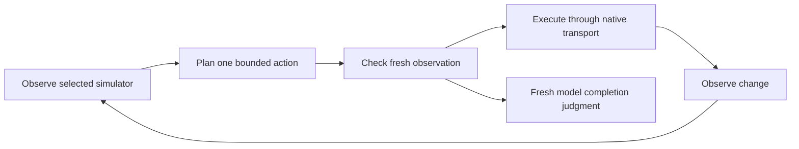

# Architecture

This describes the current source contracts. [Results](results.md) documents the
measured evidence separately. The library separates observations, provider wire formats,
planning, bounded native actions, and independent benchmark evaluation.

## Control loop

`runner.run(provider, transport, task, config)` owns this loop. `Task` preserves
the user's goal and approved literal catalog. `RunConfig` owns limits and belief
thresholds. `NativeTransport` owns tree, screenshot, and action operations; the
AXe implementation binds every command to an explicit simulator UDID. `Provider`
owns capabilities, typed decisions, generative function calls, identity, usage,
and shutdown. Provider-specific JSON stays in provider adapters.

## Planner boundaries

- **Tree:** normalizes visible accessibility state and exposes snapshot-local
  candidates. The default snapshot limit is 25 candidates; the planner additionally
  respects the provider's choice capacity. It requests typed operation, target,
  and optional literal choices, plus Noul completion judgments. Truncation can
  hide a needed control; it is not evidence that the goal is complete.
- **Grid:** receives only screenshots, goal/literals/history, and supplied geometry.
  It never obtains accessibility labels, selectors, or control bounds. Each tap
  evaluates coarse cells, then fine-cell centers using a full image and crop.
  Defaults are 4×8 coarse and 4×4 fine; requests batch at the provider's question
  limit. Pixels convert to points independently on each axis:
  `x_points = x_pixels * point_width / image_width`, similarly for y.
- **Direct:** sends accessibility state to a generative model and requires one
  real `simulator_action` function call. The adapter validates the call and its
  arguments; the planner rejects point targets and text outside the approved
  catalog. These are simulator tools, not shell commands or generated host code.

Tree freshness compares semantic snapshot digests. Grid freshness and post-action
change use images only: the current heuristic excludes the top 6% status strip,
resizes to 240×480, and compares mean RGB difference to a default tolerance of
1.5. A second check detects localized differences above 32 luminance levels
covering more than 0.1% of the resized app area (at least 64 pixels). This avoids
averaging away a changed text field or toggle while ignoring sparse caret noise.
The heuristic remains uncalibrated and can miss subtle changes. A changed screen
shows a change, not that the intended result was achieved. Grid text entry also
requires a preceding focus tap associated with the selected approved literal.

## Execution and stopping

Native taps prefer a unique accessibility identifier resolved from the fresh
snapshot, otherwise use that element's center. Grid taps use the chosen cell
center and supplied logical bounds. Text is passed through AXe stdin; replacement
and focus may require more than one native command. Operations are limited to
TAP, TYPE_TEXT, SCROLL_UP, SCROLL_DOWN, WAIT, and DONE. DONE is a judgment, not a
native mutation. Models cannot create arbitrary subprocess commands.

All modes share defaults of 20 loop steps, 120 provider-recorded model requests,
and 300 seconds. Decision batches, direct function-call requests, and fresh
completion checks consume the actual request budget. There is no separate
estimated direct-tool budget; native command/mutation counts are reported
separately. Deadline and cancellation checks happen between operations. In-flight
requests can finish over budget; cancellation prevents the next action rather
than instantly terminating work. HTTP and native timeouts are separate limits.

Three consecutive stale decisions, three actions with no observable change,
invalid output, or unsupported configuration block a run. Provider/native errors
fail it. The runner reports cancelled and budget-exhausted states explicitly.
It re-observes before acting and after mutation. DONE triggers a fresh completion
judgment, followed by another observation to detect changes during confirmation;
in direct mode this is another function-call request. Three stale confirmations
block completion. The final decision belief is retained in numeric telemetry;
direct DONE remains a categorical function call. Defaults of 0.9
for completion and 0.5 for grid-inside belief are uncalibrated policy choices.
They neither grant authorization nor establish correctness.

## Data boundaries and evidence

Cloud providers receive the actual task goal, approved literals, and observed app
content. Grid additionally transmits image data. Locality depends on the selected
endpoint, not merely the adapter's name. Ordinary telemetry retains numeric
metrics and bounded identity/status/event data, excluding raw observations,
goals, literals, answer distributions, and credentials. Explicit `observe` output
is different: it saves app content to the caller-selected destination.

`RunReport.status == "completed"` records a model's fresh completion judgment.
It does not prove task success. Benchmark planners never inspect the oracle.
The synthetic benchmark harness resets scenarios and evaluates final state with
an independent fixture oracle and final observation after control returns.
Synthetic capture evidence must not be generalized into private-app performance.

The full native matrix retains all 105 attempted episodes and valid saved proof;
local inference timing and resource observations retain all 66 attempts. Grid
had 0/30 strict native passes and remains experimental. General app quality,
causal mode comparisons and energy conclusions are not established. Source support,
mock/contract checks, installation, provider inference, native execution, and
independent outcome proof are different evidence levels. Upstream benchmark
numbers are not results for this package. Missing cost remains unknown; backend
allocated bytes are not a per-request peak, and CPU/process sampling is not a
calibrated energy measurement.

## Source map

- [Models](../src/axe_control/models.py) and
  [decisions](../src/axe_control/decisions.py): strict contracts and telemetry.
- [Runner](../src/axe_control/runner.py) and
  [context](../src/axe_control/context.py): freshness, limits, and cancellation.
- [Native transport](../src/axe_control/native.py) and
  [observation](../src/axe_control/observation.py): simulator binding and semantics.
- [Planners](../src/axe_control/policies/) and [grid geometry](../src/axe_control/grid.py):
  the three policy boundaries.
- [Providers](../src/axe_control/providers/): hosted/local wire adapters.
- [CLI](../src/axe_control/cli.py): authoritative command and flag definitions.
- [Benchmark evaluation](../benchmarks/summarize.py): independent outcome scoring.

The two project skills only guide goal preservation, mode selection, inputs,
provider/data boundaries, and reporting. They call the same library/CLI and add
no skill-routing or execution layer.
