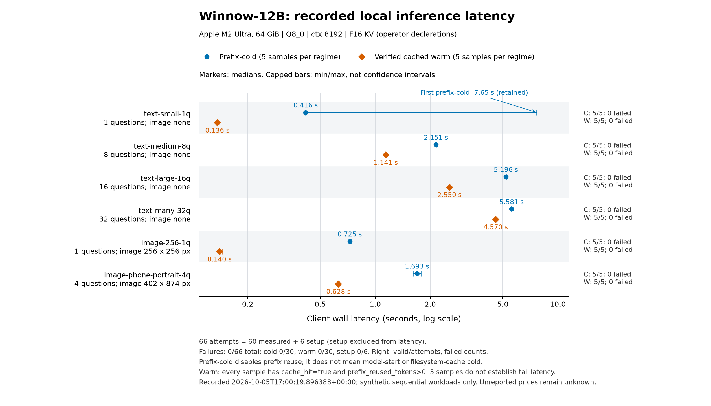

# Results

## Native control, 2026-10-05

The corrected, frozen comparison contains **105/105 matched episodes**, across
seven compatible model/mode cells, five seeded synthetic scenarios and three
repetitions. All **105 saved proof sets** are valid; all controller reports are
consistent; all seven before/after source/runtime/fixture fingerprints match.
There are **46 strict passes and 59 failures**. Failed and blocked attempts
remain in every denominator and latency plot.

A strict pass requires controller completion, independently checked native
fixture state, visible final facts and valid report/exit/proof accounting.
An independently reached app outcome can still fail when the controller refuses
completion or stops on uncertainty. These are separate measures.

### Hosted models

| Model and mode | Strict passes | Independent outcomes reached | All-attempt median wall time |
| --- | --- | --- | --- |
| GPT-4.1 mini, direct tools | 10/15 | 10/15 | 21.312 s |
| Clef, accessibility tree | 12/15 | 12/15 | 15.644 s |
| Clef, screenshot grid | 0/15 | 0/15 | 28.106 s |
| Jev 1.13, accessibility tree | 12/15 | 15/15 | 15.089 s |

### Local Winnow-12B

| Mode | Strict passes | Independent outcomes reached | All-attempt median wall time |
| --- | --- | --- | --- |
| Direct tools | 9/15 | 15/15 | 25.392 s |
| Accessibility tree | 3/15 | 4/15 | 19.406 s |
| Screenshot grid | 0/15 | 2/15 | 167.055 s |

**Grid control remains experimental: 0/30 strict passes.** All 15 Clef grid
attempts stopped below the configured tap-belief threshold. Winnow grid retained
six low completion judgments, eight repeated-no-change stops and one exhausted
time budget. Its two independently reached outcomes did not pass controller
completion. Thresholds were not lowered to make the benchmark pass.


The [full native report](../results/native-comparison/report.md) includes
per-scenario counts, passing and failed latency medians with actual sample sizes,
requests, steps, native commands, failure reasons, resolved providers and reported
costs. [Measurements](../results/native-comparison/measurements.json) supply the
plot inputs; [summary](../results/native-comparison/summary.json) audits coverage
and each saved proof set. Original episodes, stills and first-episode videos are
linked from the report. The [media review](../results/native-comparison/media-review/README.md)
retains independent review of all seven original recordings, including failures.

The run used one dedicated iPhone 17 Pro simulator, declared iOS 26.5, **402 × 874
logical points**, resetting the same synthetic app before each seeded attempt.
Each cell used **20 steps, 120 model requests and a cooperative 300-second
budget**. Controller wall time excludes app setup and video encoding. In-flight
work may finish after the time budget. Shared simulator geometry and budgets
stayed fixed, and source/runtime/fixture fingerprints matched across cells.
External hosted-provider stability is not proven by local hashes.

Models, observation modes and hosted/local execution differ, so these results
do not isolate a causal mode effect or identify a general winner. Three seeded
repeats are small and may be correlated. Local inference used a resident server
on the M2 Ultra host below; background presentation, packaging and media work
and host swap were present. A Winnow grid resource sampler timeout is retained.
Sampled whole-process RSS, CPU utilization and provider backend allocation have
different scopes and do not measure per-request memory or energy. Unreported
local cost stays unknown, not zero.

### Preserved earlier attempt

The [interrupted baseline](../results/interrupted-native/README.md) retains
100/105 episodes from the earlier renderer and its measured source archive.
It is incomplete and has a disclosed annotation defect. Separate unbooted-device
and video-destination setup failures were diagnosed before the corrected run;
they are not mixed into the model-quality comparison. The primary results above
come from one complete corrected implementation, with no spliced episodes.

## Local inference, 2026-10-05

The recorded synthetic, sequential Winnow-12B run contains **66 attempts**:
**60 measured** (six workloads, five prefix-cold and five warm samples each)
and **six setup attempts**. All 66 passed the recorded answer/schema and issue
checks, with **zero failures**, including setup. This does not establish semantic
accuracy or general application reliability.

[Raw strict Report](../results/local-performance/results.json) and
[full local report](../results/local-performance/report.md) retain every attempt.
The plot validates the current `benchmarks.inference.Report`, checks repetition
coverage and cache evidence, and recomputes summaries from raw samples. It rejects
incomplete or failed runs rather than silently charting a valid subset.



[Vector SVG](../results/local-performance/latency.svg). Markers show median client
wall latency, capped bars show the full min/max range, and the axis is logarithmic.
Each row labels question count and image dimensions and shows valid/attempted and
failed counts. The first prefix-cold **7.653479 s** observation remains included.
With five samples per regime, sample p95 equals the maximum; these are not
confidence intervals or reliable tail estimates.

Prefix-cold means prefix reuse was disabled, not model-start or filesystem-cache
cold. Every warm sample reported `cache_hit=true` and `prefix_reused_tokens>0`.
Setup remains in the attempt/failure denominator and is excluded from latency.
These measurements do not isolate a causal cache effect.

The recorded host was **Apple M2 Ultra, 64 GiB**, with Python 3.13.9 on arm64 macOS.
Model discovery reported **Q8_0, context 8192**; the operator declared Metal,
**F16 KV**, one parallel slot, and a loaded vision projector. Operator-reported
context for this run included approximately **6457.56 MiB host-wide swap** and
concurrent presentation/native-forward work. Those conditions were not isolated
or attributed to individual requests.

Across all 60 measured samples, the median wall-minus-HTTP-request interval was
**0.288 ms** (range **0.133–0.448 ms**); wall-minus-provider-native time was
**2.635 ms** (range **2.061–5.825 ms**). These paired timing differences describe
observed boundaries, not isolated overhead causes or simulator action latency.

Across all 66 attempts, 1430 whole-process resource observations recorded peak
RSS **1,565,152 KiB / 1.493 GiB**. Separately, provider diagnostics reported
backend allocation **14,664,105,984–14,668,742,656 bytes / 13.657–13.661 GiB**
against a backend budget of **55,662,788,608 bytes / 51.840 GiB**. Process RSS and
backend/device accounting are different views; do not add them or infer a small
model footprint from RSS. These are sampled observations, not per-request
allocation or capacity proof. Energy was not measured.

All **66 attempts were unpriced**: reported total cost remains **unknown/null**,
not zero. Native episode comparisons require the separate frozen 105-episode
matrix and are outside this local inference section.

Regenerate from the repository root with optional, ephemeral Matplotlib:

```sh
rtk proxy uv run --no-sync --with matplotlib python -B -m benchmarks.plot_local \
  --input results/local-performance/results.json \
  --output-dir results/local-performance
```

Both paths are CLI arguments. Add `--linear` for a linear latency axis. The
library's permanent runtime dependencies are unchanged.
