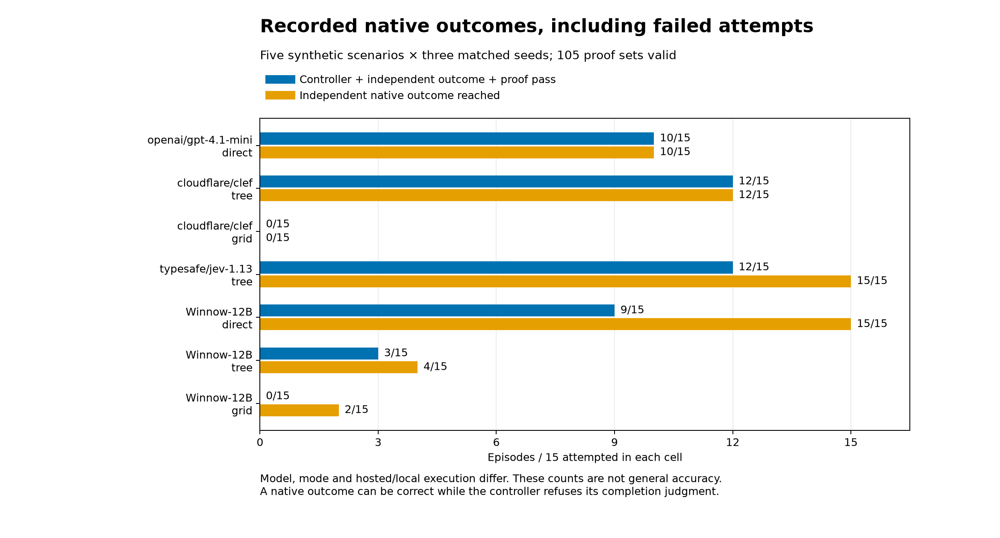
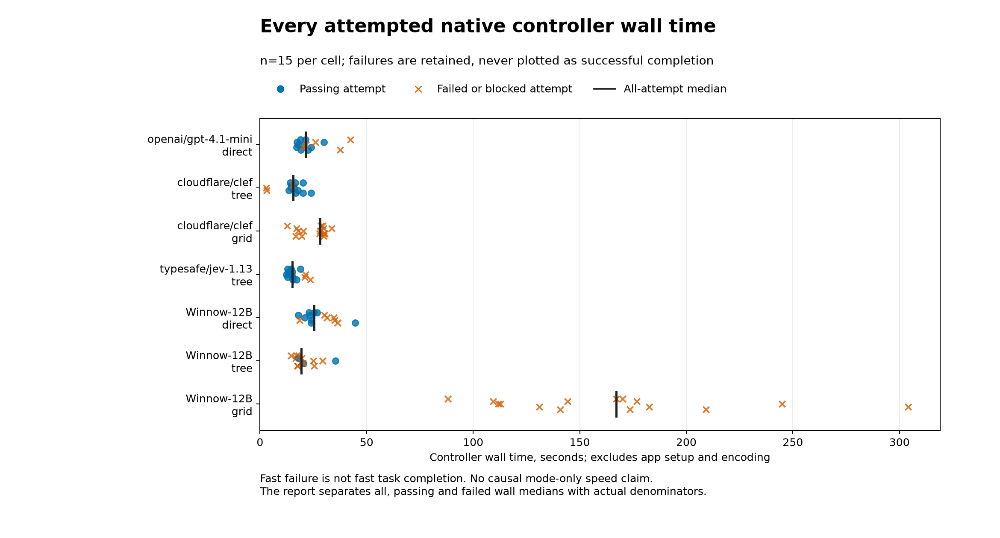

# Native controller benchmark

All **105 episodes** are retained: seven compatible model/mode cells, five
seeded synthetic scenarios, three matched repetitions. Every episode has
validated saved screenshot/tree proof and a consistent controller report.

Started `2026-10-05T18:49:03.581190+00:00`; finished `2026-10-05T20:07:45.883858+00:00`.
Frozen implementation fingerprint: `df77fdc8cda39c538d41bb1ebf5ea5bb58e4130d79078c16895d5521cd98b370`.

Declared simulator runtime: `iOS 26.5 simulator`. Logical screen: 402 × 874 points. Screenshot pixels are a separate unit; no universal display scale is assumed.

Every cell uses 20 steps, 120 model requests and a cooperative 300-second budget. In-flight requests may finish after that budget. Each scenario uses the same three seeded repetitions.

Client: Python 3.13.9; Darwin, arm64. Package versions: Pillow 12.3.0, axe-decision-control 0.1.0, httpx 0.28.1, pydantic 2.13.5.

Source hash `e1ff7338cbf15e0202a1fb231d63ce1909b2ce4103976f041a94af97d00cb7b4`; imported package hash `eed4c0b3e14e864785b42238d34103222e04a338d0e94b20924fb8e5eaee7696`; fixture hash `88ff20cc79a904ea9ce9f788fa28f40a89cc283b3aeb9a9ef7dc5d88acaab75a`. Before/after cell snapshots match the frozen expectation; this does not prove an external provider stayed unchanged.

A **pass** requires controller completion, independent fixture oracle plus
visible final facts, valid report/exit accounting and saved proof.
**Outcome reached** counts the independent native result even when the
controller refused completion. These denominators must not be conflated.

Wall time excludes app setup and video encoding. Both failed and passing
attempts are shown; a fast refusal is not fast task completion. Successful
medians condition on success and need their smaller sample counts.

## Hosted

| Cell | Pass / attempts | Outcome reached | All wall median, s | Passing wall median, s |
| --- | --- | --- | --- | --- |
| gpt-direct | 10/15 | 10/15 | 21.312 | 19.616 (n=10) |
| clef-tree | 12/15 | 12/15 | 15.644 | 16.276 (n=12) |
| clef-grid | 0/15 | 0/15 | 28.106 | not available (n=0) |
| jev-tree | 12/15 | 15/15 | 15.089 | 14.661 (n=12) |

## Local Winnow

| Cell | Pass / attempts | Outcome reached | All wall median, s | Passing wall median, s |
| --- | --- | --- | --- | --- |
| winnow-direct | 9/15 | 15/15 | 25.392 | 23.979 (n=9) |
| winnow-tree | 3/15 | 4/15 | 19.406 | 20.296 (n=3) |
| winnow-grid | 0/15 | 2/15 | 167.055 | not available (n=0) |

## Scenario breakdown

Each entry is passing episodes / 3 attempts.

| Scenario | gpt-direct | clef-tree | clef-grid | jev-tree | winnow-direct | winnow-tree | winnow-grid |
| --- | --- | --- | --- | --- | --- | --- | --- |
| basic | 3/3 | 3/3 | 0/3 | 3/3 | 3/3 | 0/3 | 0/3 |
| duration | 3/3 | 3/3 | 0/3 | 3/3 | 3/3 | 0/3 | 0/3 |
| quiet-off | 1/3 | 2/3 | 0/3 | 3/3 | 3/3 | 0/3 | 0/3 |
| prefilled | 3/3 | 3/3 | 0/3 | 3/3 | 0/3 | 3/3 | 0/3 |
| scroll | 0/3 | 1/3 | 0/3 | 0/3 | 0/3 | 0/3 | 0/3 |

## Requests, native work and reported charges

Totals include passing and failed attempts. Requests are actual HTTP attempts;
native commands include observations and execution; mutations count actual
AXe operations. A missing reported price stays unknown.

### gpt-direct

Requested `openai/gpt-4.1-mini`; mode `direct`. Resolved models: openai/gpt-4.1-mini. Resolved providers: OpenAI.

92 planner steps; 102 requests; 368 native commands; 104 mutations; 0 native failures; 114.229 s total client model-request time. $0.02833240 reported subtotal; 0 unpriced requests. 0 calls without resolved model identity.

Failed-attempt wall median: 25.932 s. Stop reasons: {'Invalid policy output or unsupported configuration': 5}.

[First original recording](gpt-direct/basic/repeat-0/original.mp4) · [Fresh final still](gpt-direct/basic/repeat-0/final.png) · [Episode](gpt-direct/basic/repeat-0/episode.json). This is the first attempt, whether it passed or failed.

### clef-tree

Requested `cloudflare/clef`; mode `tree`. Resolved models: cloudflare/clef. Resolved providers: Cloudflare.

78 planner steps; 104 requests; 319 native commands; 88 mutations; 0 native failures; 65.277 s total client model-request time. $0.01789248 reported subtotal; 0 unpriced requests. 0 calls without resolved model identity.

Failed-attempt wall median: 3.216 s. Stop reasons: {'Fresh completion judgment is below the configured threshold': 1, 'Invalid policy output or unsupported configuration': 2}.

[First original recording](clef-tree/basic/repeat-0/original.mp4) · [Fresh final still](clef-tree/basic/repeat-0/final.png) · [Episode](clef-tree/basic/repeat-0/episode.json). This is the first attempt, whether it passed or failed.

### clef-grid

Requested `cloudflare/clef`; mode `grid`. Resolved models: cloudflare/clef. Resolved providers: Cloudflare.

62 planner steps; 168 requests; 199 native commands; 42 mutations; 0 native failures; 256.131 s total client model-request time. $0.20102904 reported subtotal; 0 unpriced requests. 0 calls without resolved model identity.

Failed-attempt wall median: 28.106 s. Stop reasons: {'Grid tap belief is below the configured threshold': 15}.

[First original recording](clef-grid/basic/repeat-0/original.mp4) · [Fresh final still](clef-grid/basic/repeat-0/final.png) · [Episode](clef-grid/basic/repeat-0/episode.json). This is the first attempt, whether it passed or failed.

### jev-tree

Requested `typesafe/jev-1.13`; mode `tree`. Resolved models: typesafe/jev-1.13-20260917. Resolved providers: TypeSafe.

94 planner steps; 124 requests; 383 native commands; 105 mutations; 0 native failures; 34.755 s total client model-request time. $0.00527978 reported subtotal; 0 unpriced requests. 0 calls without resolved model identity.

Failed-attempt wall median: 21.351 s. Stop reasons: {'Fresh completion judgment is below the configured threshold': 3}.

[First original recording](jev-tree/basic/repeat-0/original.mp4) · [Fresh final still](jev-tree/basic/repeat-0/final.png) · [Episode](jev-tree/basic/repeat-0/episode.json). This is the first attempt, whether it passed or failed.

### winnow-direct

Requested `Winnow-12B`; mode `direct`. Resolved models: Winnow-12B. Resolved providers: winnow.

99 planner steps; 108 requests; 402 native commands; 114 mutations; 0 native failures; 151.577 s total client model-request time. unknown reported cost; 108 unpriced requests. 0 calls without resolved model identity.

Failed-attempt wall median: 32.965 s. Stop reasons: {'Invalid policy output or unsupported configuration': 3, 'Three actions produced no observable change': 3}.

4182 whole-process samples; peak observed RSS 1787584 KiB (1.705 GiB)
Peak sampled ps CPU 89.9%; sampling errors: none. Backend allocation range: None–None bytes.

[First original recording](winnow-direct/basic/repeat-0/original.mp4) · [Fresh final still](winnow-direct/basic/repeat-0/final.png) · [Episode](winnow-direct/basic/repeat-0/episode.json). This is the first attempt, whether it passed or failed.

### winnow-tree

Requested `Winnow-12B`; mode `tree`. Resolved models: Winnow-12B. Resolved providers: winnow.

80 planner steps; 108 requests; 329 native commands; 93 mutations; 0 native failures; 109.065 s total client model-request time. unknown reported cost; 108 unpriced requests. 0 calls without resolved model identity.

Failed-attempt wall median: 18.762 s. Stop reasons: {'Fresh completion judgment is below the configured threshold': 11, 'Invalid policy output or unsupported configuration': 1}.

3168 whole-process samples; peak observed RSS 2165568 KiB (2.065 GiB)
Peak sampled ps CPU 58.2%; sampling errors: none. Backend allocation range: 14705770496–14705770496 bytes.

[First original recording](winnow-tree/basic/repeat-0/original.mp4) · [Fresh final still](winnow-tree/basic/repeat-0/final.png) · [Episode](winnow-tree/basic/repeat-0/episode.json). This is the first attempt, whether it passed or failed.

### winnow-grid

Requested `Winnow-12B`; mode `grid`. Resolved models: Winnow-12B. Resolved providers: winnow.

121 planner steps; 303 requests; 474 native commands; 122 mutations; 0 native failures; 2099.489 s total client model-request time. unknown reported cost; 303 unpriced requests. 0 calls without resolved model identity.

Failed-attempt wall median: 167.055 s. Stop reasons: {'Fresh completion judgment is below the configured threshold': 6, 'Three actions produced no observable change': 8, 'Wall-clock budget exhausted': 1}.

23945 whole-process samples; peak observed RSS 1709728 KiB (1.631 GiB)
Peak sampled ps CPU 52.0%; sampling errors: ['Resource sampling timed out.']. Backend allocation range: 14705770496–14705770496 bytes.

[First original recording](winnow-grid/basic/repeat-0/original.mp4) · [Fresh final still](winnow-grid/basic/repeat-0/final.png) · [Episode](winnow-grid/basic/repeat-0/episode.json). This is the first attempt, whether it passed or failed.

## Limits

Synthetic FocusBench tasks only. Quality, mode, and model are confounded; these observations support no causal or general-app claims. Wilson intervals treat episodes as independent; matched repeats may be correlated.

The local cells share an owned resident server. Background presentation
captures, package builds and media checks occurred during the comparison;
the host had swap in use. Their per-episode contribution was not isolated.
Sampled process RSS and backend/device allocation
are distinct accounting views, never summed or labeled per-request peaks.
CPU is ps utilization, not energy. Three repeats do not establish stable tails,
production reliability or calibrated model beliefs. Hosted errors remain in
the failure denominator. Jev is text-only; Clef/Jev chat baselines are unsupported.

Recordings retain original native timestamps; no fixed recording FPS is claimed.
For per-scenario request/cost/failure counts and qualified Wilson intervals see
[summary.json](summary.json); for plot inputs see [measurements.json](measurements.json).
